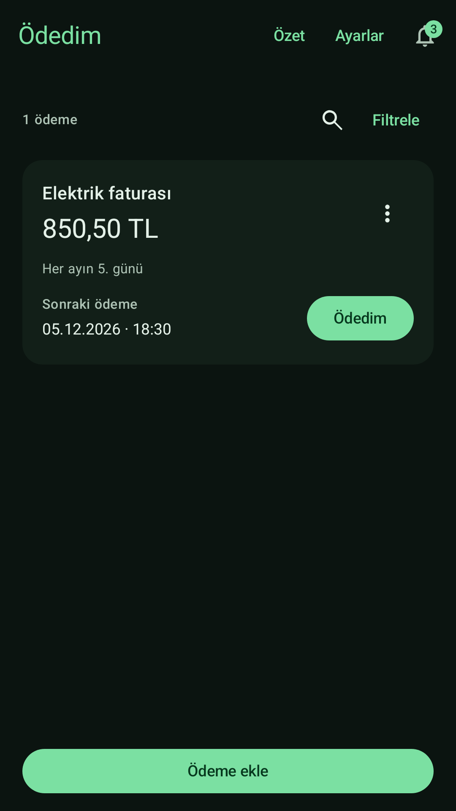
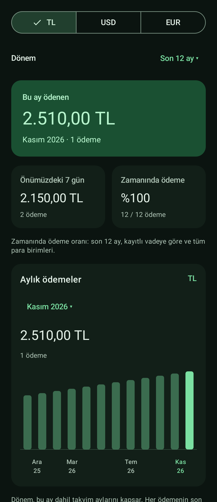
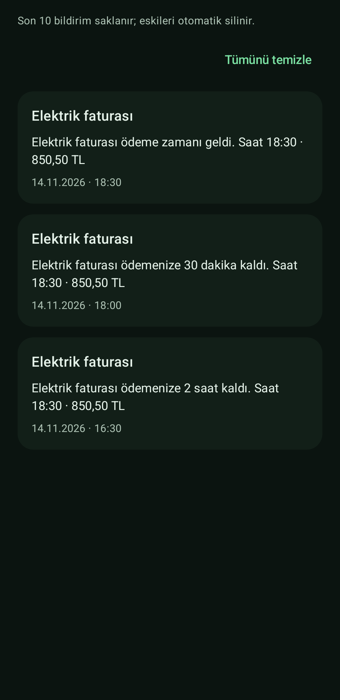

# Ödedim

Ödedim; faturaları, abonelikleri ve düzenli ödemeleri telefonda takip etmek için
geliştirilmiş, tamamen çevrimdışı çalışan bir Android uygulamasıdır.
Ödemelerin ne zaman yapılacağını hatırlatır ve ödenen kayıtların geçmişini tutar.

Kişisel kullanım için sade bir ödeme takibi sunar. Hesap açmayı veya internet
bağlantısını gerektirmez; veriler Room ile cihazda saklanır.

## Ekran görüntüleri

Örnek verilerle hazırlanmış Compose önizlemeleri:

| Ödeme listesi | Özet | Bildirimler |
| --- | --- | --- |
|  |  |  |

## Neler yapabilirsiniz?

- Ödeme ekleme, düzenleme ve silme; TL, USD ve EUR desteği.
- 30 günde bir, her ay belirlenen günde veya maaş gününde tekrar eden ödemeler.
- İlk vadeyi seçme veya daha önce yapılmış bir ödemeyi kaydetme.
- **Ödedim** ile sonraki vadeyi hesaplama; geçmişten yalnızca son ödemeyi geri alma.
- İsimle arama; para birimi, tutar ve tarih aralığına göre filtreleme ve sıralama.
- 1, 3, 6, 12 ve 24 aylık grafikler; para birimleri ayrı hesaplanır.
- Ödeme zamanından 1 gün, 2 saat ve 30 dakika önce, ayrıca ödeme zamanı geldiğinde bildirim.
- Son 10 bildirimi uygulama içinde görme ve temizleme.

Her ödeme için son **24 ödeme kaydı** saklanır; bu sınır 24 takvim ayı anlamına gelmez.
Daha eski kayıtlar otomatik silinir. Hatırlatmalar Ayarlar'dan açılıp kapatılabilir.

## Kullanılan teknolojiler

Kotlin, Jetpack Compose, Material 3, Room ve Android'in yerel bildirim/zamanlama API'leri.
Backend, Firebase, kullanıcı girişi veya harici servis entegrasyonu bulunmaz.

## Çalıştırma

1. Projeyi Android Studio'da açın ve Gradle senkronizasyonunu tamamlayın.
2. Android SDK 37'nin kurulu olduğundan emin olun.
3. Android 8.0 (API 26) veya üzeri bir cihaz/emülatör seçip **Run** ile çalıştırın.

Debug sürümü için release imzalama anahtarı gerekmez.
Hatırlatmalar için uygulamanın Ayarlar ekranındaki bildirim ve zamanlama izinlerini tamamlayın.

Unit testler: `./gradlew :app:testDebugUnitTest`

İmzalı APK oluşturma ve güncelleme bilgileri: [RELEASING.md](RELEASING.md).

Android Studio'dan GitHub'a ilk paylaşım: [GitHub'a yükleme rehberi](docs/GITHUB_UPLOAD.md).
